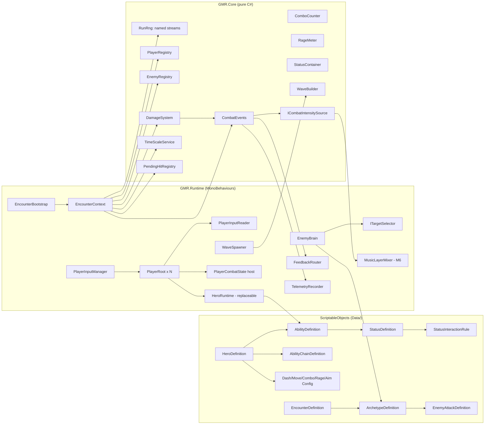
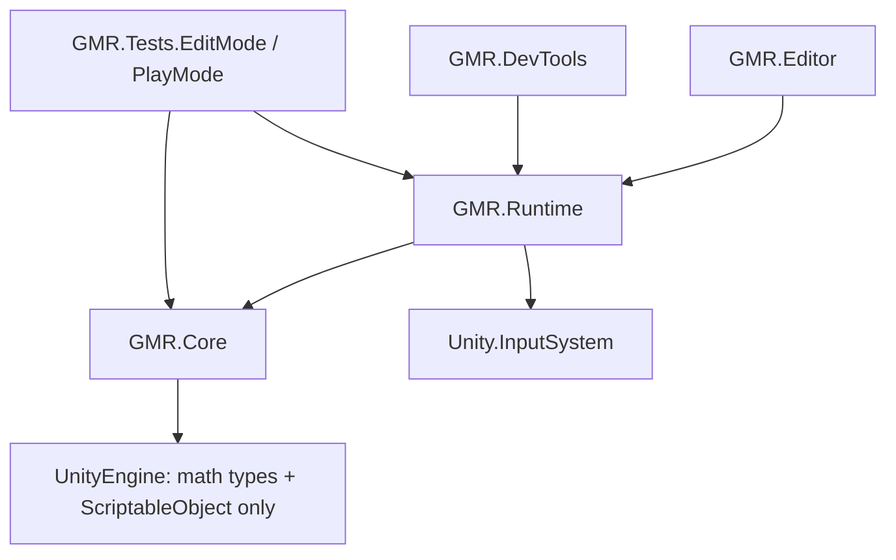

# Architecture Spine — Greek Mythology Roguelike, Combat Prototype

## Design Paradigm

**Functional core / imperative shell, on plain Unity components.**

- **Core (`GMR.Core`)**: plain C# rules and data definitions. It holds RNG, damage math, the status container, combo, RAGE, aim resolution, the input buffer, wave building and intensity math. Time comes in as an explicit `dt`, and nothing here touches scene, physics, `Time` or `Random`. Everything in Core is EditMode-testable.
- **Shell (`GMR.Runtime`)**: MonoBehaviours. They read input, run physics queries, move bodies, render, play feedback and audio, and write files. They forward facts into the Core and apply what it returns.
- **Data**: ScriptableObjects. *Definitions* (`HeroDefinition`, `AbilityDefinition`, …) hold content identity. *Configs* (`DashConfig`, `ComboConfig`, …) hold tuning. Every gameplay number lives in one of them (NFR-4).
- **No frameworks**: no DOTS/ECS, no DI container, no global event bus library. The only service root is one `EncounterContext` object, passed by hand.



## Invariants & Rules



### AD-1 — Assembly split and dependency direction

- **Binds:** all code, NFR-7, NFR-10
- **Prevents:** rules buried in MonoBehaviours, which can't be tested; cyclic assembly references; debug code leaking into gameplay.
- **Rule:** There are six asmdefs: `GMR.Core`, `GMR.Runtime`, `GMR.DevTools`, `GMR.Editor`, `GMR.Tests.EditMode` and `GMR.Tests.PlayMode`. Dependencies point only along the diagram above. `GMR.Core` may use `Vector2`, `Mathf` and `ScriptableObject` (definitions live there). It must not use `MonoBehaviour`, `Time`, `Physics2D`, `Object.Instantiate`, scene APIs, `Debug.Log` in hot paths, or any `Random`. `GMR.DevTools` has define constraint `UNITY_EDITOR || DEVELOPMENT_BUILD`. Runtime must never reference DevTools. Never name a namespace or member `Debug`, `Time`, `Input` or `Random`, because they shadow `UnityEngine` types.

### AD-2 — One RunSeed, named independent RNG streams

- **Binds:** FR-19, FR-25, FR-26, NFR-1, every random consumer (future loot/rooms/Daily Run)
- **Prevents:** a new random consumer shifting other systems' sequences; non-reproducible seeds; hidden `Random` calls.
- **Rule:** Each Encounter builds `RunRng` from one `ulong RunSeed`. Streams are **derived statelessly**: `seed_stream = SplitMix64(RunSeed ^ Fnv1a64(streamName))`. The stream algorithm is PCG32 (or xoshiro128**), hand-written in Core. Never use `string.GetHashCode`, which is not stable across runtimes. Stream names are `const string` in `RngStreams` (`Waves`, `Spawns`, `Ai`, `Combat`, `Status`, `Loot`, `Feedback`). Adding a consumer means adding a name, never reusing one. Per-entity randomness uses `stream.Derive(subName, index)`, a stateless child keyed by spawn index, so enemy count does not shift other enemies. Cosmetic-only randomness (screen-shake jitter, particle variation) uses the `Feedback` stream. Gameplay code receives an `IRng` and never constructs one.

### AD-3 — RNG ban enforcement

- **Binds:** AD-2, FR-26 consequence 3
- **Prevents:** `UnityEngine.Random` / `System.Random` slipping back in.
- **Rule:** The EditMode test `BannedApiTests` scans `game/Assets/Scripts/**/*.cs`. It fails on `UnityEngine.Random`, `Random.Range`, `Random.value`, `Random.insideUnitCircle`, `new System.Random`, `Guid.NewGuid` and `DateTime.Now` in gameplay code. The allow-list is `Scripts/DevTools/**` plus `RngStreams.cs` itself. Run it before every commit and at every milestone gate. The code-review checklist repeats the rule. A Roslyn analyzer is deferred.

### AD-4 — No static "the player"; N-player by construction

- **Binds:** NFR-2, FR-13, FR-15, FR-18, FR-24, FR-28, FR-31
- **Prevents:** singletons that block co-op; per-player state stored once globally.
- **Rule:** Players join through `PlayerInputManager` (one `PlayerInput` per Player, join behavior *manual*). Each Player gets a `PlayerId` (0..N-1) and registers in `EncounterContext.Players`. Combo, RAGE, aim, input buffer, cooldowns, HUD panel and telemetry attribution are per-Player instances. Every `DamageRequest`, status application and event carries a `SourceId` (`PlayerId` or `EnemyId`). Enemies pick targets only through `ITargetSelector` over the registry (prototype: nearest living Player). The debug command "Spawn Player 2" (`PlayerInputManager.JoinPlayer` on the next unpaired gamepad) is the acceptance test. It must work with zero changes to combat code.

### AD-5 — No mutable statics; one context object

- **Binds:** all Runtime/Core code
- **Prevents:** state leaking between Play Mode entries (domain reload is disabled for iteration speed); hidden global coupling.
- **Rule:** Enter Play Mode Options has domain reload **off**. Mutable `static` fields are banned in GMR code, enforced by review plus `BannedApiTests` with a pattern check for `static` non-`readonly` fields. `const` and `static readonly` immutable values are fine. `EncounterBootstrap` (one per Arena scene) creates `EncounterContext` and passes it via `Init(EncounterContext)` to everything it spawns. Scene objects find it once through a serialized reference to the bootstrap. Nothing calls `FindObjectOfType` / `FindFirstObjectByType` at runtime. ScriptableObjects are **read-only at runtime**: mutable state lives in `*Runtime` / `*State` classes, and an SO that must change is cloned with `Instantiate`. `static event` is banned. Input System callbacks subscribed in `OnEnable` are unsubscribed in `OnDisable`.

### AD-6 — Player state vs. Hero state (swap-proof)

- **Binds:** FR-22, FR-23, open questions 1 and 5
- **Prevents:** Hero Swap becoming an architectural fork; Combo/RAGE lost or duplicated on swap.
- **Rule:** `PlayerRoot` owns things that belong to the person: `PlayerInputReader`, `PlayerCombatState` (Combo and RAGE; it holds **no HP**, see AD-16), aim and the HUD binding. `HeroRuntime` is a child built from a `HeroDefinition`. It owns movement tuning, ability slots, cooldowns, chain state and visuals. Swap destroys `HeroRuntime` and builds the other one in place. What carries over is read from `HeroSwapConfig` (`enabled`, `cooldown`, `carryCombo`, `carryRage`, `carryHpFraction`). Shipping or dropping swap therefore changes data, not code.

### AD-7 — Input pipeline

- **Binds:** FR-1–FR-8, NFR-3, NFR-5
- **Prevents:** gameplay reading devices directly; inconsistent buffering; hard-coded keys.
- **Rule:** One `GameControls.inputactions` with maps `Gameplay` (Move, Aim, Dash, Basic, Special, Signature, Ultimate, DirectionLock, HeroSwap, Pause), `UI` and `Debug`. It has gamepad and keyboard&mouse control schemes. Only `PlayerInputReader` touches `InputAction`. Each frame it fills a per-Player `InputFrame` struct and pushes presses into `InputBuffer`, a Core class with a `BufferWindow` from `InputConfig`; a window of 0 disables buffering. Gameplay consumes `InputBuffer.TryConsume(action, now)`. `AimResolver` (Core) computes aim from move direction, DirectionLock state and assist candidates, using `AimConfig` (assist cone, range, toggles, `AimMode` enum for the FR-5 fallback). Rebinding overrides persist through `SaveBindingOverridesAsJson` in PlayerPrefs per Player slot. A rebinding UI is deferred.

### AD-8 — Data-driven abilities; polymorphism via ScriptableObject subclasses

- **Binds:** FR-9–FR-12, FR-17, NFR-4
- **Prevents:** per-hero code paths; two incompatible ways of adding effects.
- **Rule:** `AbilityDefinition` holds `AttackType` (Spin/Shot/Thrust, a tag only), `HitShape` (Circle/Projectile/Box/AllEnemies/ExpandingWave), timings (startup/active/recovery), cooldown, damage, `DamageTags`, knockback, `rootsCaster`, an optional `StatusPayload` (definition, stacks) and an optional `ProjectileConfig`. Slots are agnostic: `HeroDefinition` has `basic`, `special`, `signature`, `ultimate`, `dash`, `move`, `rage`, `chains[]` and `primaryStatus`. The Basic slot forces cooldown to 0 at validation (`OnValidate`). Ability execution is one `AbilityRunner` state machine (plain C#, per slot) plus one hit resolver per `HitShape` in Runtime. Variant behavior (chain bonuses, status behaviors, damage modifiers) is always an abstract ScriptableObject subclass, e.g. `ChainBonus` → `SplitProjectileBonus`, `ReverseKnockbackBonus`. `[SerializeReference]` is not used. Ultimates are ordinary `AbilityDefinition`s gated by `RageMeter.IsFull`.

### AD-9 — Single damage pipeline with tags and modifiers

- **Binds:** FR-13, FR-15, FR-18–FR-21, FR-24, FR-27, open question 8 (Tank armor)
- **Prevents:** code writing HP directly; Wet logic special-cased into Shock; armor needing a new path.
- **Rule:** All damage, whether ability, projectile, contact, status tick or chain jump, goes through `DamageSystem.Apply(IDamageable target, in DamageRequest req)`. The steps are:
  1. Check invulnerability (i-frames, post-hit invulnerability, spawn telegraph).
  2. Fold `IDamageModifier`s from the target's statuses and its `ArchetypeDefinition.damageModifiers`.
  3. Apply HP.
  4. Emit `HitLanded`, or `PlayerDamaged` / `HitAvoided`.

  `DamageTags` is a `[Flags]` enum (`Physical`, `Shock`, `Water`, `StatusTick`, `Ultimate`, `ChainJump`). Tank armor, if ever approved, is a `DamageModifierDefinition` asset on the archetype.

### AD-10 — Generic status system; interactions as data

- **Binds:** FR-18–FR-21, GDD §5.4 (future Burn/Curse/Slow/Rhythm), open question 2
- **Prevents:** new statuses editing core code; Wet/Shock hard-wired.
- **Rule:** `StatusDefinition` holds `id`, duration, `maxStacks`, `RefreshRule`, tint/icon and `behaviours[]` (`StatusBehaviour` subclasses with `OnApply`/`OnTick`/`OnExpire`/`ModifyIncoming`). `StatusInteractionRule` holds `whenApplied` or `whenDamageTagged`, `targetHas`, multiplier, bonus jumps, bonus radius, `consumeTargetStatus` (the Wet-consumed toggle) and a `conductedEventTag`. `StatusContainer` is Core, one per damageable entity. It stores instances with `SourceId` and resolves rules from a `StatusRuleSet` asset. Shock's chain is a `ChainLightningBehaviour`. It queries `EnemyRegistry`, breaks ties with the `Status` RNG stream, emits `ChainJump`-tagged requests attributed to the original source Player, and visits each enemy at most once per chain. Adding a status with existing behaviours means adding assets only. Adding a new behaviour means one new class, with no edits to `StatusContainer`.

### AD-11 — Typed per-encounter events; per-player Combo and RAGE as consumers

- **Binds:** FR-7, FR-13–FR-17, FR-27, FR-30, FR-31
- **Prevents:** systems polling each other; string-keyed event drift; Combo/RAGE logic duplicated in UI or telemetry.
- **Rule:** `CombatEvents` is a plain C# class on `EncounterContext`. It exposes C# `event Action<T>` and `readonly struct` payloads named in past tense: `HitLanded`, `HitAvoided`, `PlayerDamaged`, `PerfectDodged`, `DashStarted`, `AbilityUsed`, `ChainTriggered`, `StatusApplied`, `ConductedShock`, `ComboChanged`, `ComboReset`, `RageChanged`, `RageFull`, `UltimateUsed`, `HeroSwapped`, `EnemySpawned`, `EnemyDied`, `WaveStarted`, `WaveCleared`, `EncounterEnded`. Only the owning system raises an event, e.g. only `DamageSystem` raises `HitLanded`. `ComboCounter` and `RageMeter` are Core classes, one per Player, ticked with `dt`, configured by `ComboConfig` (`ComboMode` Fixed/Shrinking + curve) and `RageConfig`. They react only to events whose `SourceId` is their Player. HUD, feedback, telemetry and intensity are read-only subscribers. Subscribers unsubscribe in `OnDisable`.

### AD-12 — One owner of time scale; perfect dodge via pending hits

- **Binds:** FR-6, FR-7, FR-27, FR-29 (pause)
- **Prevents:** hitstop, Perfect Dodge slow-mo and pause fighting over `Time.timeScale`; perfect dodge detected inconsistently per enemy.
- **Rule:** Only `TimeScaleService` writes `Time.timeScale`. Callers push timed requests and the lowest active scale wins. Pause is a request with scale 0. Enemy attacks register a `PendingHit` (`attackId`, `landTime`, area) in `PendingHitRegistry` when their telegraph starts and remove it when they resolve. A dash counts as a Perfect Dodge if it starts within `DashConfig.perfectWindow` before the `landTime` of a pending hit overlapping the hero. That gives at most one per `(attackId, PlayerId)`.

### AD-13 — Enemies: one brain, archetypes as data, seeded waves

- **Binds:** FR-24, FR-25, FR-26
- **Prevents:** three divergent AI scripts; unseeded spawns; enemies bypassing targeting or telegraph rules.
- **Rule:** `EnemyBrain` (MonoBehaviour) runs one hand-written FSM. Its states are plain classes: `Spawning → Approach → Telegraph → Attack → Recover`, plus `Stunned` and `Dead`. `ArchetypeDefinition` holds stats, speed, preferred range, knockback resistance, `damageModifiers[]` and `EnemyAttackDefinition` (`AttackPattern` Charge/RangedShot/Slam, telegraph ≥ `EnemyGlobalConfig.minTelegraph`, damage, area). Per-pattern code is one `IAttackPattern` class each. Behavior variation draws from `Ai.Derive(archetypeId, spawnIndex)`. `WaveBuilder` (Core) builds the wave list from `EncounterDefinition` (wave count, budget per wave, weighted archetype table, max simultaneous, timeout) with the `Waves` stream. `WaveSpawner` picks spawn markers with the `Spawns` stream. Spawning enemies are invulnerable and harmless.

### AD-14 — Combat Intensity signal (defined now, consumed in M6)

- **Binds:** FR-31, FR-32
- **Prevents:** M6 reaching into combat internals; music logic becoming per-player-unaware.
- **Rule:** `GMR.Core` defines the following interface:

  ```csharp
  public interface ICombatIntensitySource { float Current { get; } float PerPlayer(PlayerId id); event Action<float> Changed; }
  ```

  `CombatIntensityTracker` (Core) computes it from the registries and `CombatEvents` with weights and smoothing in `IntensityConfig`. Aggregation across Players is an `IntensityAggregation` enum, default `Max`. It ships in M5, logged to telemetry only. M6's `MusicLayerMixer` depends only on the interface.

### AD-15 — Telemetry is a passive subscriber writing local JSONL

- **Binds:** FR-30, SM-1–SM-11, SM-C1–C4
- **Prevents:** gameplay code calling telemetry; uncomparable session files.
- **Rule:** `TelemetryRecorder` subscribes to `CombatEvents` only. It writes one file per session to `Application.persistentDataPath/telemetry/session-<yyyyMMdd-HHmmss>Z.jsonl`. Every line is `{schemaVersion, t, frame, type, ...}`, and each Encounter ends with one `encounter_summary` line carrying the FR-30 aggregates and the RunSeed. Writes are buffered and flushed at encounter end and on quit. Nothing is sent over the network. Wall-clock time is allowed here only; `DateTime.UtcNow` is on the AD-3 allow-list for this file.

### AD-16 — Single owner per combat mutation

- **Binds:** AD-6, AD-9–AD-12, FR-6, FR-7, FR-13, FR-23, FR-27
- **Prevents:** two components both mutating HP, knockback, invulnerability or status ticks; events raised from two places; chain-jump recursion.
- **Rule:** Each item has exactly one owner, listed below. Nothing else writes it or raises it.

| State / event | Sole owner |
| --- | --- |
| HP (absolute) | `Health` (Core), one per damageable. Only `DamageSystem` mutates it. Hero Swap copies `Health.Fraction` through `HeroSwapper` when `carryHpFraction` is set. |
| Invulnerability | `InvulnerabilityTracker` (Core), one per damageable. Dash i-frames, post-hit, spawn and Ultimate startup only *register timed windows*. `IDamageable.IsInvulnerable` reads it. |
| Knockback | `DamageSystem` computes the final impulse into `DamageResult`: `req.Knockback × (1 − KnockbackResistance)`, after modifiers. Only the target's `ApplyResolved` applies it, via `Rigidbody2D.AddForce(…, Impulse)`. |
| Status ticking | `StatusTicker` (Runtime, `Update`) ticks each registered damageable's `StatusContainer` once per frame. |
| Re-entrancy | `DamageSystem.Apply` enqueues. Requests raised during resolution (chain jumps, on-apply effects) run FIFO in the same frame, with a safety cap of 256 per frame. |
| Modifier fold | Status modifiers come first (container order), then archetype modifiers (list order). Within that, flat adds apply before multipliers. `ChainParams` is mutated only inside this fold. |
| `HitLanded`, `HitAvoided`, `PlayerDamaged`, `EnemyDied` | `DamageSystem` |
| `StatusApplied`, `ConductedShock` | `StatusContainer` |
| `DashStarted`, `PerfectDodged` | `DashController`. Perfect Dodge uses scaled time, the same clock as `landTime`. `HitAvoided` grants no RAGE; only `PerfectDodged` does. |
| `AbilityUsed`, `ChainTriggered`, `UltimateUsed` | `AbilityRunner` |
| `ComboChanged`/`ComboReset`, `RageChanged`/`RageFull` | `ComboCounter`, `RageMeter` |
| `HeroSwapped` | `HeroSwapper` |
| `EnemySpawned`, `WaveStarted`, `WaveCleared`, `EncounterEnded` | `WaveSpawner` (the last one from `EncounterBootstrap`) |

## Consistency Conventions

| Concern | Convention |
| --- | --- |
| Namespaces | `GMR.Core.<Area>`, `GMR.Runtime.<Area>`, `GMR.DevTools`, `GMR.Editor`, `GMR.Tests`. Areas: `Rng, Controls, Players, Heroes, Abilities, Combat, Status, Enemies, Encounter, Feedback, UI, Audio, Telemetry`. |
| Type naming | Content SO = `*Definition`. Tuning SO = `*Config`. Runtime per-instance = `*Runtime` / `*State`. Events = past-tense structs. Interfaces start with `I`. One public type per file, and the file name matches the type. |
| Asset naming | `Hero_Heracles`, `Ability_Heracles_ClubStrike`, `Chain_Heracles_Thunderhead`, `Status_Shock`, `Rule_WetConductsShock`, `Enemy_Chaser`, `Encounter_Prototype`, `Config_Dash_Heracles`. AI music: `AI_PLACEHOLDER_*` under `Audio/Placeholder/` plus `manifest.md`. |
| IDs | Definitions carry a stable `string id` (used in telemetry and RNG `Derive`), validated unique by an Editor check. `PlayerId`/`EnemyId` are `readonly struct` wrappers over `int`. `SourceId` is a tagged union of them. |
| Units and time | 1 unit = 32 px. Durations in seconds (`float`). Percentages as 0–1 floats in code (RAGE 0–1). Core receives `dt`/`now` from the shell. Gameplay uses scaled time, UI unscaled. |
| Update order | Movement and physics in `FixedUpdate`. Input read, ability runners, combo/RAGE ticking in `Update`. The order is set explicitly with `[DefaultExecutionOrder]`: InputReader −100, gameplay 0, feedback/HUD +100. |
| Hit detection | Melee and area hits use `Physics2D.Overlap*` queries with layer masks. Projectiles use trigger colliders. Layers: `Player, Enemy, PlayerHitbox, EnemyHitbox, Projectile, Wall`. |
| Errors and logging | Core throws on programmer error (bad config) and never logs per frame. Runtime validates SOs in `OnValidate` and at bootstrap. Logs use `UnityEngine.Debug`, prefixed `[GMR/<Area>]`. Use the Unity 6 API names: `Rigidbody2D.linearVelocity`, `FindFirstObjectByType` (editor/dev only), and `Physics2D.Overlap*` with `ContactFilter2D` plus a reused `List<Collider2D>`. |
| Config change | Tuning SOs are read live each use (not cached at Awake), so Play Mode edits apply immediately where feasible (NFR-4). |
| Feedback | `FeedbackRouter` maps events to feedback through `FeedbackConfig` (hitstop light/heavy, shake, flash, damage numbers, SFX hooks), each with an on/off toggle. Gameplay never calls feedback directly. |
| Tests | Every Core class with rules gets an EditMode test file `<Type>Tests.cs`. Tests use `new` and `ScriptableObject.CreateInstance` only, with no scenes. |

## Key Signatures (seed)

```csharp
// GMR.Core.Rng
public interface IRng { uint NextUInt(); float Value01(); int Range(int minIncl, int maxExcl); float Range(float min, float max); IRng Derive(string name, int index = 0); }
public sealed class RunRng { public RunRng(ulong runSeed); public ulong Seed { get; } public IRng Stream(string name); }
public static class RngStreams { public const string Waves="waves", Spawns="spawns", Ai="ai", Combat="combat", Status="status", Loot="loot", Feedback="feedback"; }

// GMR.Core.Combat
[Flags] public enum DamageTags { None=0, Physical=1, Shock=2, Water=4, StatusTick=8, Ultimate=16, ChainJump=32 }
public readonly struct DamageRequest { public readonly SourceId Source; public readonly float Amount; public readonly DamageTags Tags; public readonly Vector2 Knockback; public readonly StatusPayload Status; public readonly int HitId; }
public readonly struct EntityId { public readonly int Value; }      // PlayerId/EnemyId wrap int; SourceId = (SourceKind Kind, EntityId Id)
public readonly struct StatusPayload { public readonly StatusDefinition Def; public readonly int Stacks; }   // Def == null means none
public struct ChainParams { public int MaxJumps; public float Radius; public float Falloff; }
public readonly struct DamageResult { public readonly float Dealt; public readonly bool Killed; public readonly bool Avoided; public readonly Vector2 KnockbackImpulse; public readonly DamageTags Tags; public readonly SourceId Source; }
public sealed class Health { public Health(float max); public float Current { get; } public float Max { get; } public float Fraction { get; } public void SetFraction(float f); }
public interface IDamageable { EntityId Id { get; } bool IsAlive { get; } bool IsInvulnerable { get; } Health Health { get; } float KnockbackResistance { get; } StatusContainer Statuses { get; } void ApplyResolved(in DamageResult r); }
public interface IDamageModifier { void Modify(ref float amount, ref ChainParams chain, in DamageRequest req); }
public sealed class EncounterContext { public RunRng Rng; public PlayerRegistry Players; public EnemyRegistry Enemies; public CombatEvents Events; public DamageSystem Damage; public TimeScaleService TimeScale; public PendingHitRegistry PendingHits; }

// GMR.Core.Combo / Rage
public sealed class ComboCounter { public ComboCounter(PlayerId owner, ComboConfig cfg); public int Count { get; } public float WindowRemaining01 { get; } public void OnHit(); public void OnDamaged(); public void Tick(float dt); }
public sealed class RageMeter { public RageMeter(PlayerId owner, RageConfig cfg); public float Value01 { get; } public bool IsFull { get; } public void Add(RageSource src, float amount); public void Consume(); public void Tick(float dt); }

// GMR.Core.Status
public sealed class StatusContainer { public void Apply(StatusDefinition def, int stacks, SourceId src, float now); public bool Has(StatusDefinition def); public void Tick(float dt); public IEnumerable<IDamageModifier> IncomingModifiers(DamageTags tags); }
public abstract class StatusBehaviour : ScriptableObject { public virtual void OnApply(StatusApplyContext c){} public virtual void OnTick(StatusTickContext c){} public virtual void OnExpire(StatusExpireContext c){} }

// GMR.Core.Enemies / Players
public interface ITargetSelector { IPlayerTarget Select(Vector2 from, PlayerRegistry players); }
```

## Stack

| Name | Version |
| --- | --- |
| Unity Editor | 6000.6.7f1 |
| Universal RP (2D Renderer) with URP's built-in `PixelPerfectCamera` (not the legacy `com.unity.2d.pixel-perfect` package) | editor-bundled for 6000.6.7f1, pinned in `Packages/manifest.json` at M3 |
| Input System (`com.unity.inputsystem`) | 1.19.x (listed for 6000.6 in the Unity 6.6 manual), exact version pinned at M3 |
| Unity Test Framework | editor-bundled, pinned at M3 |
| C# | Unity 6 default language level |
| Git LFS | current client, `.gitattributes` committed at M3 |
| UI | uGUI + `InputSystemUIInputModule` (TextMeshPro included in uGUI 2.x) |

## Structural Seed

```text
greek-metology/                 # repo root (docs stay here: GDD.md, prompts/, _bmad*/)
  .gitignore  .gitattributes
  game/                         # Unity project root
    Assets/
      Scripts/
        Core/      GMR.Core.asmdef      # Rng, Controls(buffer, aim), Combat, Status, Combo, Rage, Abilities(defs), Enemies(defs, WaveBuilder), Encounter, Intensity, Telemetry(DTOs)
        Runtime/   GMR.Runtime.asmdef   # Bootstrap, Players, Heroes, Abilities(runners/hit resolvers), Enemies(brain, patterns), Encounter(spawner), Feedback, UI, Audio, Telemetry(writer)
        DevTools/  GMR.DevTools.asmdef  # debug menu, spawn Player 2, god mode, enemy freeze, seed entry
        Editor/    GMR.Editor.asmdef    # id validator, asset menu helpers
      Tests/
        EditMode/  GMR.Tests.EditMode.asmdef
        PlayMode/  GMR.Tests.PlayMode.asmdef
      Data/        # Heroes/ Abilities/ Chains/ Statuses/ Rules/ Enemies/ Encounters/ Config/
      Input/       GameControls.inputactions
      Prefabs/     # PlayerRoot, Hero_*, Enemy_*, Projectile_*, UI/
      Scenes/      # Sandbox.unity (M3–M4), Arena_Prototype.unity (M5+)
      Art/Placeholder/
      Audio/       Placeholder/ (AI_PLACEHOLDER_*, manifest.md)  Mixers/
      Settings/    # URP assets, 2D renderer, Input System settings
    Packages/ ProjectSettings/
```

**Git.** `.gitignore` uses the standard Unity template, rooted at `game/`: `Library/`, `Temp/`, `Obj/`, `Logs/`, `UserSettings/`, `Build*/`, `MemoryCaptures/`, `*.csproj`, `*.sln`, `.vs/`, `.idea/`, `*.pidb`, `*.userprefs`, `crashlytics-build.properties`. Asset serialization is *Force Text* and meta files are visible.

**Git LFS.** `.gitattributes` is scoped to `game/Assets/**`, so the root `images/*.png` already committed outside LFS are untouched. It tracks `*.png`, `*.psd`, `*.aseprite`, `*.ase`, `*.wav`, `*.ogg`, `*.mp3`, `*.flac`, `*.ttf`, `*.otf`, `*.fbx`, `*.exr`, `*.tga`, `*.zip`. `*.unity`, `*.prefab`, `*.asset`, `*.meta` and `*.mat` are text with `merge=unityyamlmerge eol=lf`.

**Testing.**

- EditMode (Core) covers:
  - `RunRng`: same seed gives the same sequence, and drawing from `Combat` does not change `Waves`.
  - `ComboCounter`: window, damage reset, shrinking curve.
  - `RageMeter`: fill sources, clamp, grace and decay formula.
  - `StatusContainer`: refresh, stacks, expiry, Wet→Shock ×2 and +1 jump, the `consumeTargetStatus` toggle.
  - `WaveBuilder`: same seed gives the same waves.
  - `InputBuffer`, `AimResolver` cone selection, `BannedApiTests`.
- PlayMode smoke tests:
  - `ArenaSmokeTest` loads `Arena_Prototype` with a fixed seed, runs 5 s without input, and asserts no exceptions and the expected wave-1 composition.
  - `SecondPlayerSmokeTest` joins a virtual gamepad via the Input System test fixture and asserts two registered Players with independent Combo.
- Run both from the Unity CLI: `-batchmode -projectPath game -runTests -testPlatform EditMode|PlayMode -testResults <file>`. Do not pass `-quit`, and do not pass `-nographics` for PlayMode.

**Determinism scope.** A seed reproduces wave composition, spawn points, AI variation and proc/tie-break draws. Frame-exact replay is not promised, because Physics2D and frame timing are not deterministic.

## Capability → Architecture Map

| Capability | Lives in | Governed by |
| --- | --- | --- |
| FR-1–FR-5 movement and aim | `Runtime.Heroes.HeroMover`, `Core.Controls.AimResolver` | AD-7, AD-6 |
| FR-6–FR-8 DASH, Perfect Dodge, buffer | `Runtime.Heroes.DashController`, `Core.Combat.PendingHitRegistry`, `Core.Controls.InputBuffer` | AD-7, AD-12 |
| FR-9–FR-12 slots, kits, chains | `Core.Abilities.*Definition`, `AbilityRunner`, `Runtime.Abilities.*HitResolver` | AD-8 |
| FR-13–FR-17 Combo, RAGE, Ultimate | `Core.Combo`, `Core.Rage`, `PlayerCombatState` | AD-11, AD-4 |
| FR-18–FR-21 statuses | `Core.Status`, `Data/Statuses`, `Data/Rules` | AD-10, AD-9 |
| FR-22–FR-23 select and swap | `Runtime.Players.PlayerRoot`, `HeroSwapper`, `HeroSwapConfig` | AD-6 |
| FR-24–FR-25 enemies, waves | `Runtime.Enemies.EnemyBrain`, `Core.Enemies.WaveBuilder` | AD-13, AD-2 |
| FR-26 seed | `Core.Rng` | AD-2, AD-3 |
| FR-27 juice | `Runtime.Feedback.FeedbackRouter`, `TimeScaleService` | AD-11, AD-12 |
| FR-28–FR-29 HUD, menu | `Runtime.UI` (per-Player HUD panel), `GMR.DevTools` | AD-4, AD-1 |
| FR-30 telemetry | `Runtime.Telemetry.TelemetryRecorder` | AD-15 |
| FR-31–FR-32 intensity, music | `Core.Intensity`, `Runtime.Audio.MusicLayerMixer` | AD-14 |

## Implementation Order (milestones)

"Human time" means review, Play Mode feel checks and approvals. Agent coding time is extra. ⚠ marks a milestone at risk of exceeding ~3 h.

| Milestone | Content | Est. human | Flag |
| --- | --- | --- | --- |
| **M3 Skeleton** | Project in `game/` (URP 2D), Pixel Perfect 640×400, Input System and `GameControls` maps, asmdefs (AD-1), folder tree, `.gitignore`/`.gitattributes`/LFS, domain-reload-off setting, `RunRng` + `RngStreams` + `BannedApiTests` + one green EditMode run, `Sandbox` scene with a moving square driven through `PlayerInputReader` → `InputFrame`, a one-time per-clone `git config merge.unityyamlmerge.driver` script (`tools/setup-git.ps1`), and test asmdefs referencing `Unity.InputSystem.TestFramework` | 2–3 h | OK if the agent does project creation through the CLI. LFS install on both machines is a manual one-off. |
| **M4a Movement + DASH** | `PlayerInputManager`/`PlayerRoot`/`HeroRuntime` split, movement, aim (assist + lock), `InputBuffer`, DASH with i-frames/recovery, `TimeScaleService`, `PendingHitRegistry` + a dummy "attacker" to test Perfect Dodge, debug menu toggles | 2–3 h | ⚠ M4 as written is ~5 h. Split into 4a/4b. |
| **M4b Ability slots + Heracles** | `AbilityDefinition`/`HeroDefinition`, `AbilityRunner`, Spin/Shot/Thrust resolvers, `DamageSystem` (no statuses yet), training dummies, hitstop/flash/shake via `FeedbackRouter`, Heracles 3 abilities | 2–3 h | — |
| **M5a Combat core** | `CombatEvents`, `ComboCounter`, `RageMeter` + Ultimate gate, `StatusContainer` + Shock chain, per-Player HUD, EditMode tests | 2–3 h | ⚠ M5 as written is ~10–12 h. Split into four. |
| **M5b Enemies + waves** | `EnemyBrain` FSM, 3 archetypes + patterns, `ITargetSelector`, `WaveBuilder`/`WaveSpawner`, Arena scene, results panel, Spawn Player 2 debug + PlayMode smoke tests | 3 h | ⚠ tight; slip `SecondPlayerSmokeTest` to M5c if needed |
| **M5c Theseus + synergy** | Wet + `StatusInteractionRule`, Theseus kit, chains (both), Ultimates, Hero Select + Swap (`HeroSwapConfig`) | 2–3 h | Theseus can slip without blocking SM-1/SM-2. |
| **M5d Telemetry + gate** | `TelemetryRecorder` JSONL, `CombatIntensityTracker` (telemetry only), playtest build, gate | 1–2 h + playtests | Playtests with 3 external testers are calendar time, not session time. |
| **M6 Audio** | `MusicLayerMixer` (3 sources, `PlayScheduled` on the same DSP time, mixer-group crossfade on `ICombatIntensitySource` thresholds), Audio Mixer setup | 2–3 h | ⚠ ACE-Step generation and listening iterations can exceed 3 h. Generate the layers in a separate session before M6. |

## Open Decisions / Assumptions

Decided on the user's behalf (headless):

1. Namespace root `GMR`. The Unity project lives in `game/`, a subfolder of the repo.
2. Every PRD open question is a data toggle, not a fork:
   - Hero Swap shipping: `HeroSwapConfig.enabled` (AD-6).
   - Wet consumed by Shock: `StatusInteractionRule.consumeTargetStatus`, default false (AD-10).
   - Combo/RAGE/HP carry-over on swap: `HeroSwapConfig.carry*`, default true (AD-6).
   - Tank armor: `ArchetypeDefinition.damageModifiers`, default empty (AD-9).
   - Fixed vs. shrinking Combo Window: `ComboConfig.mode` (AD-11).
   - Right-stick aim: `AimConfig.mode` (AD-7).
   - Intensity aggregation: `IntensityAggregation`, default `Max` (AD-14).
3. Domain reload disabled, with mutable statics banned (AD-5).
4. Polymorphic data uses ScriptableObject subclasses, not `[SerializeReference]` (inspector-friendly, no custom drawers).
5. RNG: hand-written PCG32 + SplitMix64 + FNV-1a. RNG ban is enforced by an EditMode text-scan test plus review. A Roslyn analyzer is deferred.
6. uGUI for HUD and menus. No Cinemachine (a simple pixel-snapped follow-and-shake camera). No Animator for combat timing (timings are data in `AbilityRunner`).
7. Melee uses physics overlap queries. Projectiles use triggers. Rigidbody2D movement runs in `FixedUpdate`.
8. Determinism is seed-level, not frame-exact replay.
9. Telemetry format is JSONL (one file per session) rather than CSV, with `schemaVersion`.
10. Input System version 1.19.x is taken from the Unity 6.6 manual. Confirm in Package Manager at M3.
11. Milestone splits 4a/4b and 5a–5d are proposed and need user approval.

Still open (needs a human):

- Approval of the M4/M5 splits.
- Whether PlayMode input-simulation tests are worth their maintenance cost for a 3 h/week team. Default: two smoke tests only.

## Deferred

- **Save/load, meta progression, Daily Run leaderboard.** Out of prototype scope. The seed foundation (AD-2) is the only hook needed now.
- **Online co-op networking and authority model.** Post-launch. AD-4 keeps logic per-Player. Netcode choice waits for the vertical slice.
- **Rebinding UI.** Overrides persist (AD-7). A UI is needed only before public builds.
- **Roslyn analyzer for banned APIs.** Add it if the text-scan test proves leaky.
- **Object pooling.** Add it only if profiling on Steam Deck (NFR-5: 15 enemies, 30 projectiles) shows GC spikes. Use `UnityEngine.Pool.ObjectPool` when needed.
- **Build/CI pipeline and Steam Deck deployment.** Manual Windows builds copied to the Deck until the vertical slice. A CI runner is not worth it at 3 h/week.
- **Addressables / asset bundles.** Direct references are enough at prototype scale.
- **Environment hazards (pits, water tiles).** Will plug into AD-9/AD-10 as damage sources and status appliers when the GDD needs them.
- **Room/map generation.** It will consume a new `Rooms` RNG stream (AD-2) in the vertical slice.
